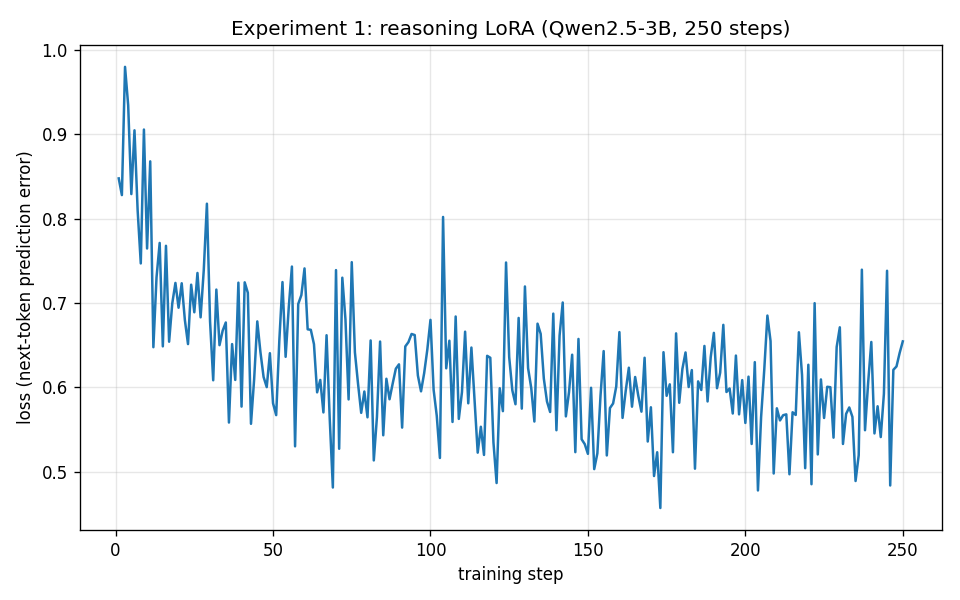

# 01 · Your first reasoner: teaching a 3B model to think

> We take a small, capable chat model and, with one LoRA fine-tune, teach it to *think step by step* inside
> `<think> … </think>` before answering. You'll watch the loss fall, see the new behavior — and then **measure**
> it on held-out math, where we get a genuinely surprising (and instructive) result. Spoiler: the model that
> learns to "reason" gets *worse* at the test, and understanding *why* is the most useful thing in this report.
>
> Prerequisite: [`00-primer.md`](00-primer.md) — this report uses *LoRA*, *adapter*, *rank/alpha*, *epoch*,
> *loss*, and *SFT* without redefining them.

This is the first time we actually train something. Everything runs on the DGX Spark; the exact commands are
at the bottom so you can reproduce every number and figure here.

---

## 1. The goal, concretely

Modern "reasoning models" (DeepSeek-R1 and its kin) don't jump straight to an answer. They first write out a
private train of thought — wrapped in literal `<think> … </think>` tags — and only then commit to a final
answer. That visible deliberation measurably improves accuracy on multi-step problems.

Our base model, **Qwen2.5-3B-Instruct**, is a strong little chat model, but it does **not** reason in that
format by default. Our job: *teach it the habit* by showing it thousands of examples of good reasoning, using
a LoRA fine-tune. We are not adding knowledge; we are installing a **behavior**.

---

## 2. The recipe (and why each ingredient)

| Choice | Value | Why |
|---|---|---|
| **Base model** | `unsloth/Qwen2.5-3B-Instruct` | Small enough to train in under an hour; the canonical small base for reasoning distillation. |
| **Data** | `open-r1/Mixture-of-Thoughts` (math subset), 2,000 traces | Public reasoning traces distilled from DeepSeek-R1. The math subset pairs with our math eval. |
| **Method** | LoRA, **rank `r=16`**, **alpha `16`** | A light-touch adapter — enough capacity to learn a *style*, small enough to train fast and resist overfitting. |
| **Length** | `max_seq_length = 4096` | Reasoning traces are long (often 3,000+ tokens); 4,096 keeps them from being chopped mid-thought. |
| **Schedule** | 1 epoch = **250 steps**, lr `2e-4`, effective batch 8 | One clean pass over the data; a standard LoRA learning rate. |

A number worth pausing on, printed by Unsloth at the start of training:

```
Trainable parameters = 29,933,568 of 3,115,872,256 (0.96% trained)
```

We are training **under 1%** of the model. The other 99% stays frozen. That single fact is why this fits on a
desktop and finishes in an hour instead of needing a cluster (see [`00-primer.md`](00-primer.md) §5).

---

## 3. Watching it learn

Training ran **250 steps in 57.5 minutes** on the Spark's GB10 (~14 s/step at sequence length 4,096 — the
unified-memory chip is capacity-rich but bandwidth-modest, so long sequences cost time). Here is the loss
curve — the model's next-token prediction error on the training data, step by step:



Read it like this. The loss starts near **0.9**, drops fast to about **0.6** within the first ~40 steps, then
settles into a noisy plateau around **0.55–0.65** for the rest of the run (mean training loss **0.625**). That
shape is the signature of a *style* fine-tune: the model very quickly learns the **format** (open with
`<think>`, work through steps, then answer), and the long tail is slow refinement of *how* it reasons. The
jitter is normal — with an effective batch of only 8 examples, each step sees a different, small slice of the
data, so the loss bounces even as the trend holds. (A falling-then-flat curve is exactly what we want; a curve
that kept plunging toward zero would be a warning sign of memorization — we chase that deliberately in
[`03-turning-the-knobs.md`](03-turning-the-knobs.md).)

---

## 4. Before vs. after (the visible change)

The first thing to check is the behavior change you can *see*. We gave the same prompts to the **base** model
and to our **tuned** model. The base model answers directly — no `<think>` tags at all (0 of 3 prompts). The
tuned model wraps every answer in a reasoning chain (3 of 3).

**Prompt:** *"Janet's ducks lay 16 eggs per day. She eats three for breakfast and bakes muffins with four. She
sells the remainder at $2 per egg. How much does she make daily?"*

**After — our tuned reasoner** (real output, lightly abridged):

> ```
> <think>
> First, she has 16 eggs. She eats 3 for breakfast: 16 - 3 = 13. She uses 4 for muffins: 13 - 4 = 9.
> She sells 9 eggs at $2 each: 9 × 2 = $18.
> ... let me double-check ... 16 - 3 = 13, 13 - 4 = 9, 9 × 2 = 18. Yep.
> ... Alternatively, with algebra: (16 - 3 - 4) × 2 = 9 × 2 = 18. Same answer.
> </think>
> Janet makes $18 every day at the farmers' market.
> ```

The change is unmistakable: the tuned model **shows its work** before answering. By the "does it reason?"
yardstick, the fine-tune is a clear success. **But that is the wrong yardstick to stop at.**

---

## 5. Measuring it (don't just vibe-check — count) — and a surprise

Seeing `<think>` tags proves the *format* changed. The question that actually matters: did the reasoning make
the model **better at math**? We held out **100 questions from GSM8K** — grade-school math word problems the
model never saw in training — and scored each version (greedy decoding, exact-match on the final number).

| Model | GSM8K accuracy (100 Qs) | Reasons in `<think>`? |
|---|---|---|
| Base `Qwen2.5-3B-Instruct` | **74%** | No |
| Our tuned reasoner | **49%** | Yes |

Read that twice. **Fine-tuning made the model worse — a 25-point drop.** The version that looks more
sophisticated (it "thinks"!) is substantially *less accurate* at the actual task.

This is the most important result in this report, and we are keeping it exactly as it landed. Had we stopped at
"it reasons now — ship it," we would have shipped a regression and never known. **A behavior you can see is not
the same as an outcome you want.** This is the same lesson the sister `g1-humanoid-rl` project learned the hard
way, when an automated scorer declared a cartwheel a "95% success" that frame-by-frame video proved was a
faceplant. Measure the thing you actually care about, with data the model didn't train on.

---

## 6. Why did it get worse? (an honest post-mortem)

We dug into the failed answers. Three compounding causes:

1. **The base model was already good — and concise.** Qwen2.5-3B-Instruct was trained by its makers to solve
   grade-school math crisply and reliably (hence 74%). It did not *need* elaborate reasoning for GSM8K.
2. **We trained it on the wrong difficulty.** `Mixture-of-Thoughts` (math) is **competition-level** olympiad
   reasoning. We taught a small model to imitate long, winding deliberation meant for *much* harder problems —
   then tested it on *easy* ones. It learned the verbosity without the payoff.
3. **The verbosity actively backfired.** The failures are *genuine reasoning errors*, not cut-off answers:
   the model talks through a problem at length and sometimes reasons itself into a wrong number (e.g., one
   problem with gold answer 70000, our model confidently concluded 1200). Long chains give arithmetic slips
   more chances to creep in, and on trivial problems the extra steps are pure downside.

In short: **supervised fine-tuning only teaches "imitate these examples."** It cannot teach *when reasoning
helps versus hurts*, because nothing in the loss function rewards a correct, efficient answer over a verbose,
wrong one. Teaching that judgment requires a **reward** signal — which is **reinforcement learning / GRPO**,
the subject of the future chapter [`05-rl-the-reasoner.md`](05-rl-the-reasoner.md), and a direct cousin of the
**PPO** the `g1-humanoid-rl` project uses to teach a robot to walk. (Note also a measurement subtlety we hit
and fixed: our first `<think>`-rate metric accidentally matched the substring in its *own* transcript template
and always read 100% — a tidy reminder that even your *measurement* code needs checking. The corrected
per-output check is what the table above uses.)

> **The takeaway is not "fine-tuning is bad."** It's that fine-tuning is a precise tool: it faithfully taught
> exactly what we asked (imitate these traces), and what we asked was mismatched to our goal. The fix is better
> *data* and a better *objective* — which is exactly where reports 03 and 05 go.

---

## 7. How would you *fix* it? (your next experiments)

The regression hands us a clear menu of things to try — each one teaches something:

- **Match the data to the goal.** Train on *grade-school*-difficulty reasoning (or shorter, cleaner traces)
  instead of olympiad problems, then re-measure on GSM8K. Hypothesis: accuracy recovers and *exceeds* 74%.
- **Ask for brevity.** Add a system prompt like "reason briefly, then answer," or lower `max_new_tokens` at
  inference. Cheap to try; quantify how much of the drop was pure verbosity.
- **Tune less, or smaller.** Fewer steps or a smaller `lora_r` (8) imprints the format more lightly — does a
  gentler touch keep accuracy while still adding reasoning? (We probe rank/alpha/epochs in
  [`03-turning-the-knobs.md`](03-turning-the-knobs.md).)
- **Change the objective entirely.** Reward *correct, efficient* answers with RL/GRPO instead of imitating
  traces ([`05-rl-the-reasoner.md`](05-rl-the-reasoner.md)). This is the principled fix.
- **Start from a base, not an instruct, model.** Qwen2.5-3B-Instruct was already optimized for this task;
  fine-tuning a *base* model (which has no such polish to lose) may show a cleaner gain from reasoning.

---

## 8. What's next

We have a trained adapter sitting on the Spark. In [`02-from-adapter-to-chat.md`](02-from-adapter-to-chat.md)
we turn it into a single servable file (GGUF), register it with Ollama, and **chat with our own reasoner in
open-webui**.

---

## Reproduce

All commands run from this repo; training runs in the `unsloth-dev` container on the Spark (see
[`../dgx-spark-finetuning-manual.md`](../dgx-spark-finetuning-manual.md)).

```bash
# 0) sync code to the Spark
scp -r scripts configs spark:chaotic-finetuning/

# 1) train the adapter (≈ 57 min) — config: configs/exp1.yaml
ssh spark "docker exec -d unsloth-dev bash -lc 'cd /workspace && \
  python -u scripts/train_lora.py --config configs/exp1.yaml > logs/exp1.log 2>&1'"

# 2) plot the loss curve
ssh spark "docker exec unsloth-dev bash -lc 'cd /workspace && \
  python scripts/plot_loss.py --run outputs/exp1-qwen3b-reasoning --out docs/reports/assets/exp1-loss.png'"

# 3) evaluate before (base) and after (tuned) on GSM8K
ssh spark "docker exec unsloth-dev bash -lc 'cd /workspace && \
  python scripts/eval_before_after.py --model unsloth/Qwen2.5-3B-Instruct --tag base --gsm8k 100 --max-seq-length 4096'"
ssh spark "docker exec unsloth-dev bash -lc 'cd /workspace && \
  python scripts/eval_before_after.py --model outputs/exp1-qwen3b-reasoning/adapter --tag tuned --gsm8k 100 --max-seq-length 4096'"
```

Config used: [`configs/exp1.yaml`](../../configs/exp1.yaml). Scripts:
[`train_lora.py`](../../scripts/train_lora.py), [`plot_loss.py`](../../scripts/plot_loss.py),
[`eval_before_after.py`](../../scripts/eval_before_after.py).
