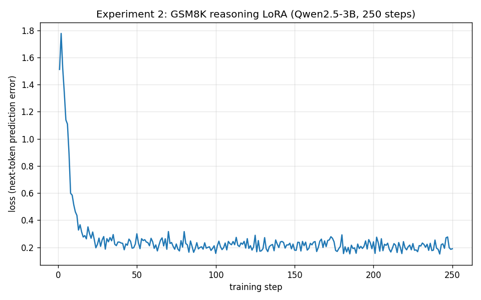

# 03 · Turning the knobs: the one that mattered was the data

> Report 01 ended on a cliffhanger: our reasoning fine-tune *looked* great but made the model **worse** at math
> (74% → 49% on GSM8K). Here we run the controlled experiment that diagnoses why — and try to fix it by
> changing exactly **one** thing.
>
> Prerequisites: [`01-first-reasoner.md`](01-first-reasoner.md) (the regression) and
> [`00-primer.md`](00-primer.md) (LoRA, epoch, loss).

When a fine-tune regresses, the instinct is to start spinning hyperparameter dials — lower the learning rate,
shrink the adapter, train fewer steps. Those are real knobs (and we'll list them), but good experimental
practice says: **form a hypothesis, then change one thing and measure.** Our post-mortem in Report 01 pointed
at a specific culprit — not a hyperparameter at all.

---

## 1. The hypothesis

Report 01's diagnosis: we taught a model that was *already good and concise* at grade-school math to imitate
**long, competition-level** reasoning traces (`Mixture-of-Thoughts`). It learned the verbose *form* of
deliberation but, on easy problems, that verbosity *hurt* — more steps meant more chances to slip, and it
sometimes talked itself out of correct answers.

If that diagnosis is right, the fix isn't a smaller learning rate. It's **matching the training data's
difficulty and length to the task we actually care about.** So that's the one thing we'll change.

---

## 2. The controlled experiment

We hold *everything* from Experiment 1 fixed — same base model, same LoRA rank/alpha, same learning rate, same
number of steps, same `<think>` output format — and change **only the dataset**:

| | Experiment 1 (Report 01) | Experiment 2 (this report) |
|---|---|---|
| Base model | Qwen2.5-3B-Instruct | Qwen2.5-3B-Instruct *(same)* |
| LoRA | r=16, α=16, lr=2e-4, 1 epoch | *(same)* |
| Output format | `<think>…</think>` | `<think>…</think>` *(same)* |
| **Data** | **`Mixture-of-Thoughts` (competition math)** | **`GSM8K` train (grade-school math)** |
| Reasoning length | long (often 3,000+ tokens) | short (~100–200 tokens) |

GSM8K's training split comes with concise, step-by-step solutions written for *exactly* this kind of problem.
We wrap that reasoning in the same `<think>` tags so the only real differences are **difficulty and length**.
Crucially, GSM8K's train and test splits are disjoint — we train on `train[:2000]` and still evaluate on the
same held-out `test[:100]` from Report 01, so the numbers are directly comparable.

> This is what "turning the knobs" really means: not blindly sweeping, but isolating the variable your
> hypothesis blames and measuring its effect. Data is a knob — often the most powerful one.

---

## 3. Result

| Model | Training data | GSM8K acc (100 Qs) | Reasons in `<think>`? |
|---|---|---|---|
| Base Qwen2.5-3B | — | 74% | No |
| Exp 1 reasoner | competition math | 49% | Yes |
| **Exp 2 reasoner** | **grade-school math** | **68%** | Yes |

**Changing only the data recovered 19 of the 25 lost points (49% → 68%).** The hypothesis holds: the
competition-math data — not any hyperparameter — caused most of the regression. And the qualitative change is
just as striking. Here is the *same* problem that made Experiment 1 ramble for 300 words:

> ```
> <think>
> In May, Natalia sold 48 / 2 = 24 clips.
> Altogether, Natalia sold 48 + 24 = 72 clips.
> </think>
> The answer is **72**.
> ```

Concise, correct, done. The overthinking is gone — because the *training data* modeled concise reasoning. You
can see it in the loss curve too: Experiment 2 drops to ~0.2 (vs ~0.6 for the verbose data) because short,
regular reasoning is far easier to fit.



**But notice what did *not* happen: we recovered most of the loss, yet still didn't beat the base model's
74%.** That's the second, subtler lesson. Qwen2.5-3B-Instruct was *already* heavily optimized by its makers for
exactly this kind of math — so a quick 2,000-example LoRA, however well-matched, has little room to improve on
it and still carries some risk of perturbing a polished skill. **Fine-tuning pays off most when you're adding a
capability the base lacks — not when you're competing with something it already does well.** To actually
*exceed* a strong base on its home turf, you need to optimize for the outcome directly (correct answers), which
is reinforcement learning — Report 05.

---

## 4. The other knobs (and what they do)

Data was our prime suspect, but for completeness here are the dials you'd reach for next, and the intuition for
each (all live in `configs/*.yaml`):

- **`lora_r` (rank)** — adapter capacity. Higher = can learn more complex changes, but more memory and more
  overfitting risk. If a fine-tune *under*-learns a style, raise it; if it memorizes, lower it.
- **`lora_alpha`** — how loudly the adapter speaks. Often set to `r` or `2r`. Raising alpha amplifies the
  adapter's effect (and its mistakes).
- **`learning_rate`** — step size. Too high → unstable, forgets the base model's skills (a fast route to
  regression); too low → barely learns. `2e-4` is a safe LoRA default.
- **`num_train_epochs`** — passes over the data. More epochs deepen the imprint but invite **overfitting**:
  watch for a training loss that keeps falling while held-out accuracy drops.
- **`max_seq_length`** — how much of each example the model sees. Too short truncates reasoning mid-thought.

---

## 5. What you learned

- **Diagnose before you dial.** A regression is a clue, not a defeat — read the failures, form a hypothesis,
  change one variable.
- **Data difficulty and length are first-class hyperparameters.** Matching them to the target task moved
  accuracy 19 points (49% → 68%) — far more than any numeric knob would have.
- **Fine-tuning has the most upside when you add a *new* skill, not when you compete with the base model's
  existing strengths.** We recovered the regression but couldn't beat an already-expert base; surpassing it
  needs a different objective (RL), not more imitation.

Next: [`04-scaling-up-qlora.md`](04-scaling-up-qlora.md) — take a working recipe and run it on a **70B** model
the Spark's 128 GB unified memory can hold but a normal GPU can't.

---

## Reproduce

```bash
# Experiment 2: identical recipe, grade-school data (configs/exp3.yaml)
ssh spark "docker exec -d unsloth-dev bash -lc 'cd /workspace && \
  python -u scripts/train_lora.py --config configs/exp3.yaml > logs/exp3.log 2>&1'"

# Evaluate on the same held-out GSM8K test slice as Report 01
ssh spark "docker exec unsloth-dev bash -lc 'cd /workspace && \
  python scripts/eval_before_after.py --model outputs/exp3-qwen3b-gsm8k/adapter --tag exp2 --gsm8k 100 --max-seq-length 2048'"
```

Config: [`configs/exp3.yaml`](../../configs/exp3.yaml) (a one-line diff from `exp1.yaml` — only the dataset).
