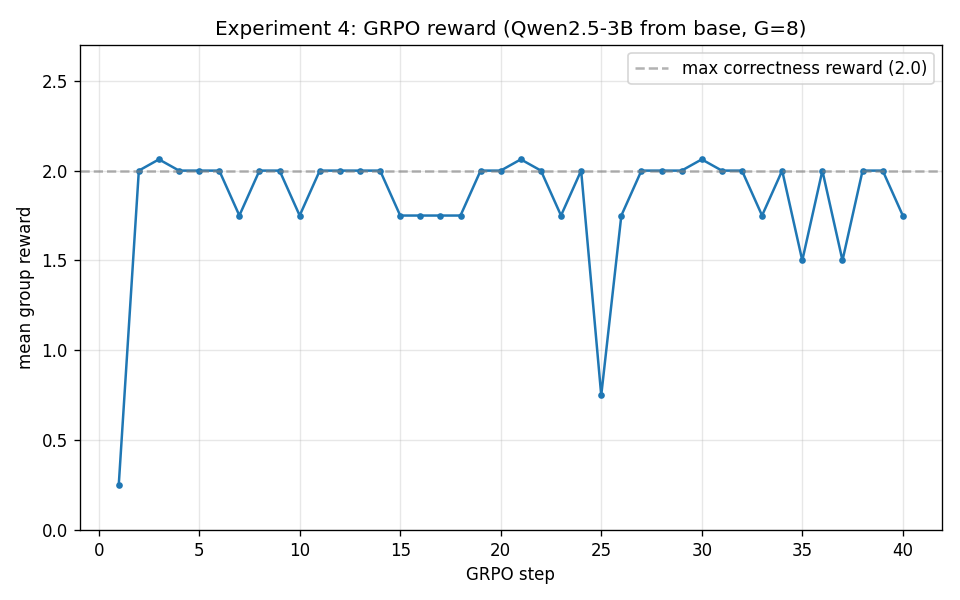
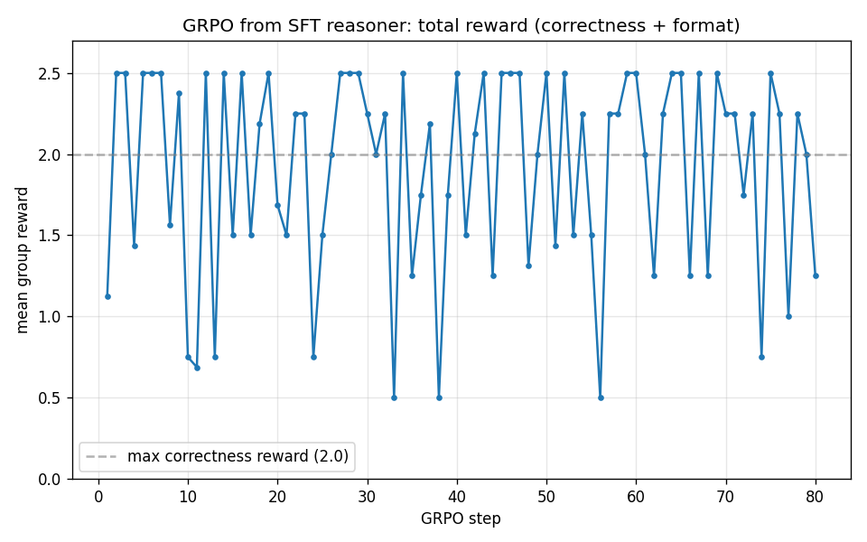
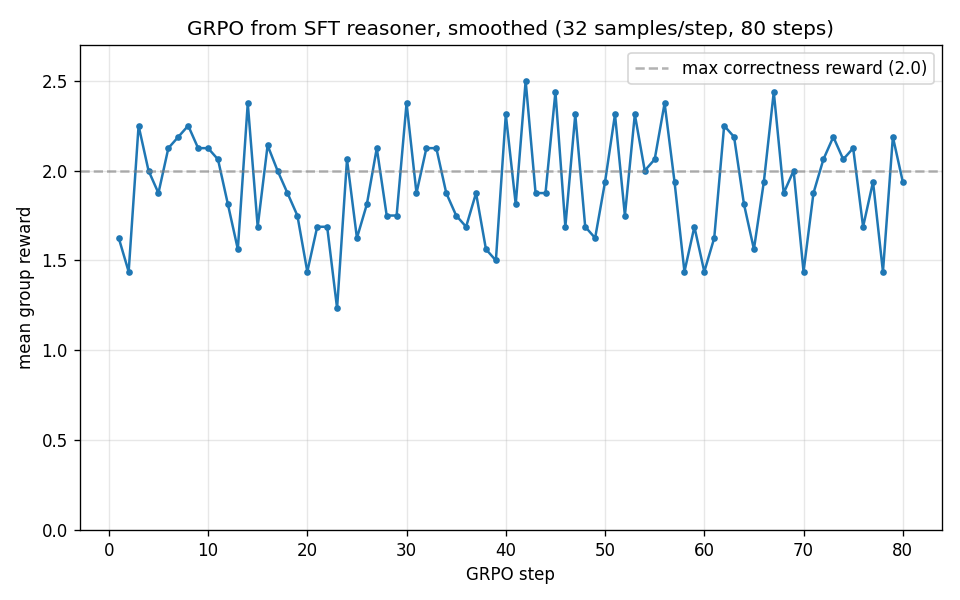

# 05 · RL the reasoner: GRPO, and the bridge to the walking robot

> Every experiment so far used **supervised** fine-tuning — "imitate these examples." That's why Report 01's
> model could *look* like a reasoner but get *worse*, and why Report 03 could recover but never *beat* the base.
> To make a model genuinely better at a task, you stop showing it answers and start **rewarding** good ones.
> That's reinforcement learning — and it closes the loop with the sister `g1-humanoid-rl` project.
>
> Prerequisites: [`01-first-reasoner.md`](01-first-reasoner.md) and [`03-turning-the-knobs.md`](03-turning-the-knobs.md)
> (the limits of imitation).

---

## 1. Why imitation hits a ceiling

Supervised fine-tuning (SFT) optimizes one thing: *make the model's output look like the training answer.*
It has no notion of **correct**. If the training data rambles, the model rambles (Report 01). If the training
data is concise and right, the model imitates that — but can never get *better* than its examples, because
"better than the example" isn't something the loss can even see (Report 03's 68% < the base's 74%).

To surpass the teacher, you need a signal that says *"this answer was actually correct"* — and rewards the
model for finding its own path to correct answers. That signal is a **reward**, and learning from it is
**reinforcement learning (RL)**.

---

## 2. What GRPO does (in plain language)

In RL the model is called the **policy** — the function that takes a prompt as input and produces an answer (a sequence of tokens) as output. Training the policy means adjusting it so it produces answers that earn higher rewards.

**GRPO** = **Group Relative Policy Optimization** — the RL method DeepSeek used to build R1. One training step:

1. **Sample a group.** For one question, let the current model generate **G** different answers (say 8). **Sampling** here means generating with some randomness (unlike greedy decoding, which always picks the single most-likely token) — so you get G *different* answers, some better, some worse, which gives GRPO something to compare.
2. **Score them.** Run each answer through **reward functions**. Ours give **+2 if the final number is correct**
   and **+0.5 if it used the `<think>…</think>` format**. No human labels — the reward is computed.
3. **Compare within the group.** Compute each answer's reward *relative to the group's average*. Answers that
   beat the group average get reinforced (made more likely next time); below-average ones get discouraged.

That "relative to the group average" is the clever bit. Classic RL (PPO) needs a second neural network — a
*value model* — to estimate "how good is this situation?" as a baseline. GRPO throws that away and just uses
**the group's own average reward as the baseline**. Less memory, fewer moving parts — which is exactly why it
fits comfortably on a Spark.

---

## 3. The bridge to the walking robot 🤖

Here is the through-line of this whole project. The sister `g1-humanoid-rl` repo teaches a humanoid robot to
walk using **PPO** (Proximal Policy Optimization). GRPO is PPO's close cousin. The *same* idea drives both:

| | G1 robot (`g1-humanoid-rl`) | Our reasoner (this report) |
|---|---|---|
| **Policy** | neural net: sensors → joint targets | neural net: prompt → tokens |
| **Action** | 50 joint angles, 50×/sec | the next token |
| **Reward** | stay upright, track commanded velocity | final answer correct, used `<think>` |
| **Algorithm** | PPO | GRPO (PPO without the value network) |
| **What's learned** | *how to move* to earn reward | *how to reason* to earn reward |

In both cases you don't *tell* the policy the right action — you *reward outcomes* and let it discover a policy
that earns reward. A robot learning that "keeping my center of mass over my feet avoids falling" and a language
model learning that "checking my arithmetic avoids wrong answers" are, mathematically, the *same kind* of
learning. That symmetry is why the same person can run both on the same desktop.

---

## 4. The reward we designed

`scripts/train_grpo.py` defines two reward functions (the entire "objective" of the RL run):

```python
def correctness_reward(prompts, completions, answer, **kwargs):
    # +2.0 if the model's final number matches the gold answer, else 0
    ...

def format_reward(completions, **kwargs):
    # +0.5 if the answer is wrapped in <think>...</think>
    ...
```

Designing rewards is the craft of RL — and its main hazard. A reward that's easy to "game" produces a policy
that games it (the `g1` project has a whole *reward-hacking gallery* of robots that maximized reward while
doing something absurd). Our correctness reward is hard to game — you can't fake the right number — which is
what makes it a good teacher.

---

## 5. Result — and two honest lessons hiding in a flat line

We ran 40 GRPO steps (group size 8) starting from the **base** Qwen2.5-3B, ~21.5 s/step (~14 min). Here's the
mean group reward per step:



The mechanism clearly *works* — it samples groups, scores them, and updates the policy. But the reward doesn't
climb: after a cold first step (0.25), it pins to the **~2.0 correctness ceiling** and stays there, while the
**format reward sits at 0.0 the entire run.** That flat line is not a disappointment — it's two of the most
important lessons in RL, made visible:

**Lesson 1 — RL needs *headroom*.** The reward is already near its maximum from step 2, because the base model
*already* answers most GSM8K questions correctly (~74%, from Report 01). There's almost nothing for RL to
improve — you can't climb a hill you're already standing on top of. RL pays off when the model is *not* already
maxing the reward: harder problems, or a weaker starting policy.

**Lesson 2 — RL can't learn from scratch what the model never tries (the cold-start problem).** The format
reward (+0.5 for `<think>`) never once fired — because the base model never *samples* a `<think>` answer, so
GRPO never sees one to reinforce. **RL can only amplify behaviors the policy already produces sometimes.** This
is precisely why DeepSeek-R1 — and our own series — does **SFT first** (to *install* the reasoning habit), and
only *then* RL (to *sharpen* it). The flat format-reward line is the experimental proof of why reports 01–03
had to come before this one.

> Put the pieces together and you've independently re-derived the real recipe for a reasoning model:
> **SFT to plant the behavior → RL, on problems with headroom, to make it correct.** Each of our five
> experiments shows why one of those pieces is necessary.

### 5b. The follow-up: we fixed the cold-start — and hit the *real* cost of RL

The flat run above had two problems (no headroom, cold-start). We fixed the cold-start: we re-ran GRPO starting
from the **Report-03 concise reasoner** (which already writes `<think>`) instead of the base, on GSM8K problems
it had **not** seen during SFT (`train[2000:]`, to guarantee genuine headroom), for 80 steps. Here's the
reward:



**The cold-start fix worked, cleanly:** the format reward now fires on **every single step (+0.5)** — versus a
flat **0.0** in the base run. Starting from a model that *can* reason means RL finally has the behavior to
reinforce. The peaks at **2.5** are the model scoring full marks: correct answer (2.0) *plus* the `<think>`
format (0.5). That's the SFT→RL handoff, demonstrated.

**But the curve still doesn't climb** — it ricochets between 0.5 and 2.5 with no upward trend (first-half mean
1.42 vs second-half 1.49). The obvious objection is "that's just noise — you ran one prompt × 8 generations per
step, so each step's reward is dominated by *which problem got sampled*." Fair. So we ran it again, harder.

**We killed the noise — and it was still flat.** A second run averaged **4 prompts × 8 generations = 32 samples
per step** (4× smoother), doubled the learning rate, and ran 80 steps on the Spark (~1.3 hours):



The smoothing did its job — the curve is visibly tighter — and there is *still* no climb (first-half 1.39 vs
second-half 1.44). So the flatness isn't a sampling artifact; it's real. Two things explain it: the concise
reasoner is already near its achievable ceiling on grade-school math (limited headroom), and **80 steps is
simply not enough RL** — real runs use thousands. We *could* get a climb by starting from a weaker model with
more headroom (our verbose 49% Experiment-1 reasoner), but on this hardware that run's generation step ballooned
the ETA to **~15 hours** without vLLM. Which is the lesson, quantified.

Did either run move the needle on held-out accuracy? This is where it gets instructive.

| GRPO run | start acc | after acc | eval size |
|---|---|---|---|
| 1-prompt (noisy) | 68% | 69% | 100 Qs |
| smoothed (32/step) | 68% | **72%** | 100 Qs |
| smoothed — **re-checked** | **70%** | **70%** | **200 Qs** |

Read those three rows top to bottom — they're a lesson in themselves. The smoothed run looked like a **win**:
68% → 72%, a +4-point climb, finally! But +4 on 100 questions is right at the edge of noise (±~5%), so we
re-ran the before/after on **200** questions to be sure. The gain **vanished: 70% → 70%.** The +4 was sampling
noise all along.

So the honest, confirmed verdict: **at this scale, GRPO did not improve accuracy.** That matches the flat
reward curves exactly. RL's *prerequisites* — a policy that already reasons, and a clean, un-gameable reward —
are cheap to demonstrate on a desktop, and we did (cold-start: fixed). RL's *gains* are expensive: they need
real headroom and thousands of steps (with vLLM to afford the generation), which is a datacenter job, not a
one-hour one.

> **And the deepest lesson is the one the table accidentally taught:** a +4-point "improvement" on 100 questions
> evaporated on 200. *Never trust a small-sample delta.* This is the same trap Report 01 flagged and the sister
> `g1-humanoid-rl` project lived (a scorer that called a faceplant a "95% success"). Measure the thing you care
> about, with enough data to believe it. If this series teaches you one habit, let it be that one.

---

## 6. Honest caveats

- **RL is expensive.** Each step generates G full answers *before* it can learn anything — many times more
  compute per step than SFT. On the Spark's capacity-not-speed profile, a serious GRPO run is a long job; what
  we show here is a **demonstration of the mechanism**, not a converged model.
- **Reward design is everything.** Get the reward wrong and you get a confident, well-formatted, wrong model.
- **vLLM would help.** Production GRPO uses vLLM for fast sampling; we ran without it for simplicity, which is
  part of why it's slow.

---

## 7. What you learned (and where the series lands)

- **SFT imitates; RL optimizes.** To beat a strong baseline you must reward the *outcome you want*, not just
  show examples — but *optimizing* takes far more compute than *imitating*, so the gains need real scale (we
  fixed RL's prerequisites on a desktop; the gains stayed out of reach).
- **Always confirm a small win on a bigger eval.** Our most memorable result was a +4-point "climb" that turned
  out to be noise — caught only because we re-measured on more data.
- **GRPO = PPO minus the value network**, using a group's average reward as the baseline — simpler, lighter,
  Spark-friendly.
- **Reasoning models and walking robots are trained by the same idea.** A reward signal shaping a policy is the
  common engine under both halves of this work.

That closes the arc: from "what is a weight?" (`00`), through a first LoRA and its honest failure (`01`–`03`),
to a 72B model on a desktop (`04`), to the reinforcement learning that powers both modern reasoners and the G1
robot (`05`). You now have the whole toolkit — and a Spark to run it on.

---

## Reproduce

```bash
# What we ran (from the base model — shows the cold-start + no-headroom lessons):
ssh spark "docker exec -d unsloth-dev bash -lc 'cd /workspace && \
  python -u scripts/train_grpo.py --steps 40 --num-generations 8 --out outputs/exp5-grpo-3b > logs/grpo.log 2>&1'"
```

**To get a *climbing* reward curve** (the satisfying version), give RL both a behavior to sharpen and room to
improve: start `--model` from a merged **SFT reasoner** (so it already emits `<think>` and the format reward
fires), and point the data at **harder problems** where the base isn't already at ceiling (e.g. the
competition-math set, or GSM8K's hardest items). That's the natural next experiment — and the full R1 recipe.

Script: [`train_grpo.py`](../../scripts/train_grpo.py).
