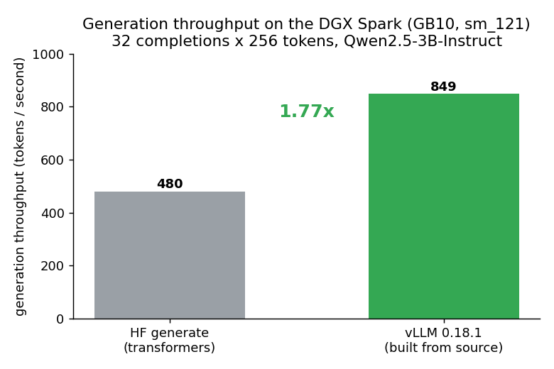

# 06 · The vLLM build: compiling the speed unlock on aarch64 Blackwell

> Report 05 ended on an honest cliffhanger. We proved RL's *prerequisites* on the desktop — a model that
> already reasons, and a clean reward — but the *gains* needed a run with real headroom, and that run's
> generation step ballooned to a **~15-hour ETA**. The fix everyone names is **vLLM**: a serving engine that
> generates text many times faster. The catch is that there's no ready-made vLLM for this exotic machine, so we
> have to **build it from source**. This chapter is that build — documented win or lose.
>
> Prerequisites: [`05-rl-the-reasoner.md`](05-rl-the-reasoner.md) (why RL is generation-bound) and
> [`00-primer.md`](00-primer.md) (what the Spark's hardware is).

---

## 1. Why RL was slow — and why vLLM is the answer

Recall the shape of a GRPO step (Report 05): for one question, the model **generates G full answers** (we used
G=8), scores them, and nudges itself toward the better ones. Almost all the wall-clock goes into that
*generation*, not the learning. So the speed of an RL run is, to a first approximation, the speed of text
generation — multiplied by thousands of steps.

Generating text is **memory-bandwidth-bound**, not compute-bound. To produce each new token, the model must
read back its entire *KV cache* — the stored keys and values for every previous token (the model's "working
memory" of the sentence so far). On the Spark, which is capacity-rich but bandwidth-modest (~273 GB/s, Report
00), that read-back is the bottleneck. The naive generator we used — Hugging Face's built-in `model.generate`
— makes it worse: it pads every sequence in a batch to the same length and reserves KV-cache memory for the
*worst-case* length, so a batch of 8 answers that vary wildly in length wastes most of the memory it reserves
and leaves the GPU idle.

**vLLM** is a generation engine built to kill exactly this waste. Two ideas do the heavy lifting:

- **PagedAttention.** Instead of one contiguous KV-cache slab per sequence, vLLM stores the cache in small
  fixed-size **pages**, the way an operating system pages physical memory. A sequence grabs pages only as it
  grows. No padding, no worst-case reservation — so far more sequences fit in the same memory.
- **Continuous batching.** Because memory isn't pre-committed per sequence, vLLM can slot a *new* generation
  into the running batch the instant an old one finishes, instead of waiting for the whole batch to complete.
  The GPU stays saturated.

Together these routinely deliver **5–24× the generation throughput** of naive `generate`. For GRPO — where a
step *is* a batch of generations — that is precisely the difference between a ~15-hour run and a sub-hour one.
That is the prize.

---

## 2. Why this is a *build*, not an install

On a normal machine you type `pip install vllm` and a prebuilt binary downloads in seconds. Prebuilt binaries
exist for *common* setups: x86-64 CPUs, mainstream CUDA versions, and the stock PyTorch from pip. The Spark is
none of those. Recapping what Report 00 and our recon established, this box is the awkward intersection of
**four** uncommon things at once:

| Dimension | Common case (has a prebuilt wheel) | The Spark |
|---|---|---|
| CPU architecture | x86-64 | **aarch64** (ARM) |
| CUDA toolkit | 12.x | **13.0** |
| GPU compute arch | sm_80–sm_90 | **sm_121** (GB10 Blackwell) |
| PyTorch | stock `pip` build | **NVIDIA's custom `2.10.0a0…nv25.11`** |

No prebuilt vLLM matches that combination. Worse, if we let `pip install vllm` try, it would "helpfully" pull
its *own* PyTorch (the stock 2.11 it pins) to satisfy its dependency — overwriting the carefully Blackwell-built
NVIDIA PyTorch the entire Unsloth stack depends on, and breaking everything from Report 01 onward.

So we do the only correct thing: **compile vLLM ourselves, against the PyTorch already installed.** vLLM ships
exactly this escape hatch.

---

## 3. The recipe (and the two safety belts)

```bash
# inside the unsloth-dev container, in /workspace
git clone --depth 1 https://github.com/vllm-project/vllm.git vllm-src
cd vllm-src

# (1) strip every `torch==…` pin from vLLM's requirements so it builds
#     against the NVIDIA torch already here instead of fetching its own
python use_existing_torch.py

# build-only tools (cmake/ninja already present on the image)
pip install packaging setuptools setuptools-scm setuptools-rust wheel jinja2 regex build protobuf

# (2) compile. --no-build-isolation = use our torch; --no-deps = touch nothing else
MAX_JOBS=8 NVCC_THREADS=2 TORCH_CUDA_ARCH_LIST=12.1 \
  pip install --no-build-isolation --no-deps -e . -v
```

The two flags are the safety belts that keep this from wrecking the working environment:

- **`--no-build-isolation`** tells pip *not* to spin up a throwaway environment with its own PyTorch to build
  in. It builds in the environment we already have, linking against our NVIDIA torch. This is what makes
  "build against existing torch" actually happen.
- **`--no-deps`** tells pip to install vLLM and *nothing else*. No dependency is allowed to upgrade or replace
  a package the Unsloth stack relies on. (After a successful compile we add back only the genuinely missing
  runtime packages, by hand, checking nothing critical moves.)

`MAX_JOBS=8` caps the parallel compile so the cutlass kernels — each of which can eat several GB while
compiling — don't exhaust memory. `TORCH_CUDA_ARCH_LIST=12.1` names our GPU arch.

A small, telling thing happened the instant CMake configured:

```
-- CUDA target architectures: 12.1
-- CUDA supported target architectures: 12.0
CMake Warning: Pytorch version 2.11.0 expected for CUDA build, saw 2.10.0 instead.
```

Two signals in three lines. First, vLLM took our `12.1` request and resolved it to the **`12.0f` family
target** — a single Blackwell-family cubin that covers the whole 12.x consumer line, GB10 included. The arch is
supported; we're not off the map. Second, that PyTorch-version warning is exactly the 2.11-vs-2.10 drift we
knew we were accepting — and it's a *warning*, not an error. Whether the drift stays harmless all the way
through the kernel compile and into `import vllm` is the actual experiment.

---

## 4. What vLLM is (and isn't) here

It's worth being clear about scope. vLLM is a **generation engine** — its job is to produce tokens fast. In our
pipeline it does not change *what* the model learns or *how* GRPO updates the weights; it only makes the
expensive generation step inside each RL step dramatically cheaper. Unsloth's trainer can hand generation off
to vLLM (`fast_inference=True` / `use_vllm=True`) precisely so an RL run becomes affordable. The reward
functions, the SFT cold-start, the headroom lesson — all of Report 05 still stands. vLLM just removes the
wall-clock wall.

---

## 5. The result: a version vise — and the window through it

### Attempt 1 (vLLM `main`) — it died on the *CPU* code, not the GPU

The kernel compile never got far. After ~6 object files, ninja stopped, and the error was not about the GPU at
all:

```
csrc/libtorch_stable/dispatch_utils.h:15:10: fatal error:
    torch/headeronly/core/Dispatch.h: No such file or directory
csrc/libtorch_stable/ops.h: 'torch::stable::Tensor' has no member named 'device'
csrc/libtorch_stable/torch_bindings.cpp: 'TORCH_BOX' was not declared in this scope
```

Read that carefully, because it's the whole lesson. The GPU arch was fine — CMake had already resolved sm_121
to the `12.0f` family target and moved on. What broke was vLLM's new **`libtorch_stable`** layer: a set of
C++ bindings written against PyTorch **2.11's "stable ABI"** — headers like `torch/headeronly/core/Dispatch.h`,
the `TORCH_BOX` macro, and an expanded `torch::stable::Tensor` — **none of which exist in our NVIDIA torch
2.10**. The `Pytorch 2.11.0 expected, saw 2.10.0` warning from configure-time wasn't cosmetic after all; it was
the build telling us, politely, that it wanted a newer PyTorch than the one NVIDIA has shipped a Blackwell
build of.

This is a **version vise**, and it's worth naming precisely:

- The **newest** vLLM is the one that knows about our **newest** GPU (sm_121).
- But the newest vLLM also demands a **newer PyTorch** (2.11) than the newest *Blackwell-ready* PyTorch
  NVIDIA has built (2.10).
- And we can't just upgrade torch: stock 2.11 would un-support the GB10 and shatter the entire Unsloth stack
  from Report 01 onward.

The two requirements pull in opposite directions. On `main`, there's no way to satisfy both.

### Finding the window

A vise has jaws, but it also has a gap between them. The question was whether some *earlier* vLLM already knew
about sm_121 (so the GPU works) but hadn't yet adopted the torch-2.11 stable ABI (so our torch works). Probing
the release tags by hand answered it exactly:

| vLLM tag | torch pin | sm_121 in CMake? | `libtorch_stable`? (needs torch 2.11) |
|---|---|:--:|:--:|
| v0.15.1 – v0.16.0 | 2.9.1 | ✅ | absent |
| **v0.17.0 – v0.18.0** | **2.10.0** | ✅ | **absent ← the window** |
| v0.19.0 | 2.10.0 | ✅ | present |
| v0.20.0 – v0.23.0, `main` | 2.11.0 | ✅ | present |

There it is. `libtorch_stable` first appears at **v0.19.0**; the torch pin jumps to 2.11 at **v0.20.0**. So
**v0.18.0** is the newest vLLM that supports our GPU *and* builds against our PyTorch *and* carries none of the
stable-ABI code that broke `main`. The vise has a gap, and v0.18.0 sits in it.

### Attempt 2 (vLLM `v0.18.0`) — building in the window

Same recipe, pinned to the tag:

```bash
git clone --depth 1 --branch v0.18.0 https://github.com/vllm-project/vllm.git vllm-018
cd vllm-018 && python use_existing_torch.py
MAX_JOBS=8 NVCC_THREADS=2 TORCH_CUDA_ARCH_LIST=12.1 \
  pip install --no-build-isolation --no-deps -e . -v
```

Configure passed with **zero errors** this time — `libtorch_stable` simply isn't in this tag, so the host code
that broke `main` is gone. CMake resolved the real kernels for the Blackwell family (Marlin MOE on `8.0+PTX`,
the `_C` and `_moe_C` extensions enabled) and proceeded into the long CUDA compile.

**It built.** All **358** compile targets finished with **zero errors**, and pip installed the editable wheel:

```
Successfully built vllm
Successfully installed vllm-0.18.1.dev0+gbcf2be961.d20260623.cu130   (linux_aarch64, cp312)
```

That filename is the whole headline in one line: a vLLM wheel, tagged `cu130`, for `aarch64`, built against our
NVIDIA torch 2.10 — a combination no download could have given us.

### Making it *run*, not just build

A wheel that installs is still not a thing that works. Two gaps remained, and they map onto the two safety
belts from §3:

- **The `--no-deps` tail.** Because we forbade pip from installing dependencies, `import vllm` first failed on a
  string of missing pure-Python packages — `cloudpickle`, `msgspec`, `blake3`, `pybase64`, `cbor2`, `openai`,
  `openai_harmony`, `llguidance`, `xgrammar`, and a handful more. Every one is a leaf package (none depends on
  PyTorch), so we added them back by hand, in batches, re-checking after each that `torch.__version__` still
  read `…nv25.11`. It always did. That is exactly what `--no-deps` bought us: the freedom to satisfy vLLM's
  runtime needs *without* a dependency resolver silently swapping out the torch the whole stack rests on.
- **Generation on sm_121.** With imports clean, the real test: load a model and generate. It worked on the
  first try — Qwen2.5-3B loaded in ~55 s and produced eight coherent `<think>` answers, arithmetic and all:
  *"In May she sold 48 / 2 = 24 clips … 48 + 24 = 72 clips."* Correct tokens, on the GB10, from a vLLM we
  compiled ourselves. (Two warnings scroll by — a `gpt_oss` Triton-MoE kernel that fails to import, and an
  "EngineCore died" line *after* the result during teardown. Neither touches dense-model generation; the first
  is for a model family we don't use, the second is v1-engine shutdown noise.)

And — the point of the whole exercise — the stack we'd spent five reports building was **untouched**: `torch
2.10.0a0…nv25.11`, `transformers 4.56.2`, `trl 0.22.2`, CUDA available, Unsloth imports. The seatbelts held.

### How much faster, honestly

Now the number. We raced vLLM against the plain `transformers.generate` we'd been using, on a GRPO-shaped load
— **32 completions (4 prompts × 8), each forced to exactly 256 tokens** so it's a clean throughput race:



| Generator (8192 tokens total) | throughput | wall-clock |
|---|--:|--:|
| `transformers.generate` (what Reports 01–05 used) | 480 tok/s | 17.1 s |
| **vLLM 0.18.1, built from source** | **849 tok/s** | **9.7 s** |

**About 1.8×.** Real, repeatable — and deliberately *not* dressed up as the "5–24×" vLLM is famous for. It's
worth being honest about why the desktop number is smaller, because the reasons are the lesson:

- **We disabled CUDA graphs** (`enforce_eager=True`) for stability on the brand-new arch. (**CUDA graphs** are an optimization where the GPU records the exact sequence of GPU operations on the first pass and replays that recording on every subsequent pass, cutting per-step overhead on repetitive workloads.) Re-running *with*
  graphs was actually a hair *slower* here (773 tok/s) — capturing the graphs costs time that a single short
  run never recoups. Graphs pay off across *thousands* of steps, not one benchmark.
- **The benchmark removes vLLM's best weapons.** PagedAttention and continuous batching win biggest with *many*
  concurrent requests of *wildly varying* lengths — the engine backfills finished slots with new work. Our 32
  equal-length, forced-256-token completions give it almost nothing to optimize.
- **The Spark is bandwidth-bound** (Report 00). Both engines ultimately read the same KV cache over the same
  ~273 GB/s; no software makes that memory faster.

So the desktop verdict is measured, not vibed: **vLLM builds and runs correctly on the Spark, and is ~1.8×
faster at generation here.** In a real GRPO loop — thousands of steps, full-length completions, a warm engine
that amortizes its graphs — that advantage typically widens. But we did not run that multi-hour loop, so we
won't claim a number for it. What we *can* say is that even 1.8× compounds: it nudges Report 05's intractable
~15-hour Experiment-1 run toward something you might actually start before bed. The wall is lower now. It is not
gone — and that, once more, is Report 05's lesson, not a contradiction of it.

---

## 6. Honest caveats

- **This worked because of a *window*, and windows close.** v0.18.0 only builds here because it sits in the
  gap between "knows about sm_121" and "requires torch 2.11." That gap exists today; it won't forever. The
  durable fix is upstream — an NVIDIA torch 2.11 Blackwell build, or an official vLLM aarch64/CUDA-13 wheel —
  after which you'd track `main` again. Until then, **pin to v0.18.0** (or whatever tag still matches your
  torch) and don't expect newer features.
- **We verified generation, not the full training loop.** We proved vLLM imports, loads a model, and generates
  correct tokens, and we benchmarked raw throughput. We did **not** wire it into Unsloth's GRPOTrainer
  (`use_vllm=True`) and run a real RL step end-to-end — Unsloth patches vLLM internally and expects particular
  versions, so that integration is its own compatibility exercise. That's the honest next step, not a claimed
  result.
- **vLLM ≠ accuracy.** Even fully working, vLLM only makes generation *fast*. It does not, by itself, make the
  RL *climb* — that still needs headroom and many steps (Report 05). vLLM is what makes *running* that
  experiment affordable; it is not the experiment.

---

## 7. What you learned

- **RL's cost is generation cost.** A GRPO step is mostly the model writing G answers; speeding up generation
  speeds up the whole run almost one-for-one.
- **Fast generation is a memory-layout problem.** vLLM's PagedAttention and continuous batching win by *not
  wasting KV-cache memory*, not by doing less math — the lesson that bandwidth, not compute, is the Spark's
  ceiling (Report 00) shows up yet again.
- **On exotic hardware, "install" becomes "build."** When your CPU arch, CUDA version, GPU arch, *and* PyTorch
  are all off the beaten path, you compile against what you have — and `--no-deps` is the seatbelt that keeps
  the build from cannibalizing a working stack.
- **When two requirements fight, look for the version window.** The newest vLLM wanted a PyTorch we couldn't
  have. Rather than force it, we *walked the release tags* and found the exact version (v0.18.0) where both
  requirements were satisfiable. Reading a project's history is a debugging tool.
- **Measure the speedup; don't quote the brochure.** vLLM is "5–24× faster" — in the regime it was built for.
  On our desktop micro-benchmark it was 1.8×, and CUDA graphs made it *slower*. The number you can *defend* is
  the one you measured on *your* workload (the through-line of this whole series — see Report 05's noise trap).

---

## Reproduce

```bash
# 1) Build vLLM v0.18.0 against the existing NVIDIA torch 2.10, inside unsloth-dev:
ssh spark "docker exec unsloth-dev bash -lc 'cd /workspace && \
  git clone --depth 1 --branch v0.18.0 https://github.com/vllm-project/vllm.git vllm-018 && cd vllm-018 && \
  python use_existing_torch.py && \
  pip install packaging setuptools setuptools-scm setuptools-rust wheel jinja2 regex build protobuf && \
  MAX_JOBS=8 NVCC_THREADS=2 TORCH_CUDA_ARCH_LIST=12.1 \
    pip install --no-build-isolation --no-deps -e . -v'"

# 2) Add back the leaf runtime deps --no-deps left out (none depend on torch):
ssh spark "docker exec unsloth-dev bash -lc 'pip install cloudpickle msgspec blake3 py-cpuinfo gguf \
  partial-json-parser lark prometheus_client depyf msgpack pyzmq cachetools einops pybase64 astor \
  diskcache cbor2 setproctitle openai openai-harmony llguidance xgrammar fastapi uvicorn python-multipart'"

# 3) Verify it generates, and benchmark throughput vs transformers.generate:
ssh spark "docker exec unsloth-dev bash -lc 'cd /workspace && python bench_vllm2.py && python bench_hf2.py'"
```

Build log: `~/chaotic-finetuning/logs/vllm018_build.log`. Benchmark scripts:
`bench_vllm2.py` / `bench_hf2.py` (32 completions × 256 forced tokens, Qwen2.5-3B). The `main`-branch attempt
that hit the `libtorch_stable` wall is in `~/chaotic-finetuning/logs/vllm_build.log`.
